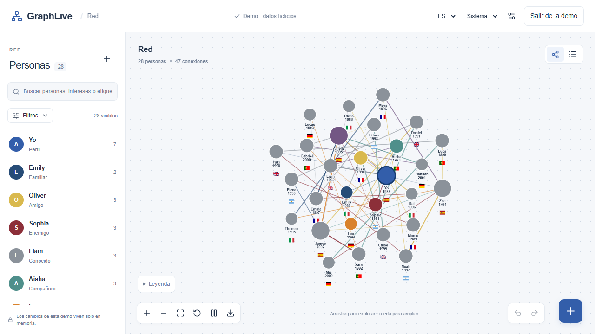

# GraphLive — 0.1.0-alpha.1

Edición web sin servidor: [GraphLive en GitHub Pages](https://iamsboby.github.io/GraphLive/). Guarda la red en el navegador o en una carpeta local. [Despliegue y límites de almacenamiento](docs/github-pages.md).

Español · [English](README.en.md)

Red privada de personas y relaciones, con grafo interactivo, archivos JSON, interfaz en español e inglés y modo claro/oscuro. Proyecto TypeScript estricto, React y Next.js, preparado para instalarse en un servidor propio.


## Inicio rápido

Node.js 22.13+ (rama 22) o 24+ y npm:

```sh
npm ci
touch .env.local
npm run dev
```

En Windows, `New-Item .env.local -ItemType File` y, si hace falta, `npm.cmd`. Abrir **http://localhost:3000**. Elegir almacenamiento, crear el perfil principal y añadir personas. «Explorar una red ficticia» usa 28 personas aisladas en memoria.

Sin autenticación, la instancia es compartida: los comandos escuchan solo en loopback. Antes de exponerla a otras personas, configurar OAuth o protección externa. No colocar `DATA_DIR` dentro de una carpeta pública.

## Páginas

- `/`: presentación, acceso a la demo y regreso a la red abierta.
- `/login`: acceso, selección de almacenamiento y apertura de una red.
- `/graph`: editor del grafo. Si se abre sin una red en memoria, vuelve a `/login`.

El logotipo GraphLive vuelve al inicio sin cerrar la red durante la navegación interna. Una recarga completa requiere volver a abrir los datos guardados; la demo vive solo en memoria. Las transiciones respetan la preferencia de movimiento reducido.

## Uso

- Añadir/editar personas y relaciones desde la ficha; cada conexión aparece en ambos extremos.
- Arrastrar nodos, fijarlos, ampliar, centrar y recalcular el layout. El cálculo se detiene tras estabilizarse.
- Buscar sin distinguir acentos, combinar filtros, consultar rutas y usar la vista de tabla o la lista con teclado.
- Configuración: tamaño por métrica, etiquetas, perfil principal, búsqueda privada por notas, backups y transferencia JSON/ZIP.
- En conflicto: descargar el borrador, revisar la decisión y conservar explícitamente una versión. No se sobrescribe silenciosamente.

## Comandos

| Comando                        | Función                                           |
| ------------------------------ | ------------------------------------------------- |
| `npm run dev`                  | desarrollo en localhost:3000                      |
| `npm run typecheck`            | TypeScript estricto                               |
| `npm run lint`                 | ESLint                                            |
| `npm test`                     | unitarias e integración                           |
| `npm run check`                | tipos + lint + pruebas                            |
| `npm run build`                | compilación de producción                         |
| `npm run start`                | servidor de producción                            |
| `npm run test:e2e`             | Playwright sobre producción; ejecutar build antes |
| `npm run benchmark`            | 500/1.000 nodos, validación y métricas            |
| `npm run format`               | Prettier                                          |
| `docker compose up --build -d` | despliegue opcional con volumen                   |

Las pruebas E2E usan Microsoft Edge de forma predeterminada y puerto 3100. Para Chromium: instalarlo con Playwright y establecer `PLAYWRIGHT_CHANNEL=chromium`. No necesitan cuentas cloud.

## Documentación

- [Arquitectura y decisiones](docs/architecture.md)
- [Modelo de datos](docs/data-model.md)
- [Persistencia, archivos y recuperación](docs/storage.md)
- [Sincronización y conflictos](docs/synchronization.md)
- [Seguridad y riesgos](docs/security.md)
- [Instalación, configuración, variables, OAuth y Docker](docs/deployment.md)
- [SbobyPiShare: endpoints reales y requisitos pendientes](docs/sbobypishare-integration.md)
- [Contribución](docs/contributing.md)
- [Árbol del repositorio](docs/repository-tree.md)

## Estructura

`app/` contiene rutas y estilos; `packages/domain` el esquema y operaciones; `graph-engine` métricas y Worker; `storage-core` contratos y exportación; `storage-adapters` persistencia; `sync-engine` fusión; `auth`, `security` y `config` infraestructura; `ui` componentes; `i18n` traducciones. El proyecto mantiene un solo paquete npm para simplificar instalación y build.

## Captura



## Límites principales

Los datos activos son JSON sin cifrar; usar disco cifrado. Backups del servidor pueden cifrarse con AES-256-GCM. Una carpeta local no sincroniza dispositivos. El repositorio servidor se prueba con una instancia y disco local, no con un clúster distribuido. Login OAuth requiere credenciales propias y una prueba real de despliegue. Integraciones cloud, avatares y creación de aristas por arrastre no están habilitados. El ZIP representa la red actual y no incluye el historial de backups.

Licencia MIT. Dependencias fijadas mediante `package-lock.json`.
