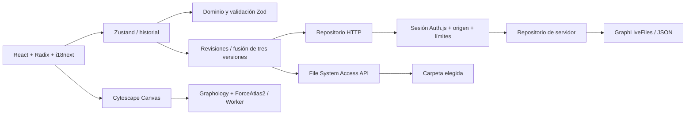

# Arquitectura y decisiones

GraphLive es una aplicación Next.js App Router con runtime Node.js. El repositorio es un único paquete npm con módulos internos; se evita un monorepo de múltiples paquetes publicables hasta necesitarlo. TypeScript estricto comparte tipos y esquemas entre el navegador y las rutas API.

## Decisiones

- **Next.js y despliegue propio**: se preserva el requisito de archivos JSON en disco privado y Docker. No se sustituye por una base de datos alojada ni se publica una instancia con autenticación desactivada.
- **Cytoscape + Graphology**: Cytoscape dibuja en canvas y ofrece zoom, selección y arrastre. ForceAtlas2 calcula 150 iteraciones en un Web Worker y después se detiene. Se evita movimiento indefinido. La simulación se reinicia con Recalcular.
- **Persistencia**: un snapshot validado es el punto de commit; los archivos de personas e índices son proyecciones reparables. Es imposible hacer atómica una transacción que modifica muchos JSON mediante múltiples renombrados independientes.
- **Zustand**: mantiene red, versión base, estado de escritura, historial de 30 pasos y conflictos. Encola ediciones que llegan durante un guardado. No guarda después de cada tecla del formulario.
- **Auth.js/next-auth 4 estable**: proveedores Google y Microsoft; identidad del espacio derivada de proveedor y `providerAccountId`, nunca del nombre o del correo. Tokens de proveedores no se guardan en archivos ni se usan para Drive/OneDrive.
- **i18next**: recursos ES/EN completos para los controles implementados; pruebas de paridad de claves. Códigos técnicos, nombres propios y entradas del usuario no se traducen.
- **Tailwind + CSS**: Tailwind está configurado; los tokens y componentes visuales están en `app/globals.css` para mantener una identidad coherente sin añadir una segunda biblioteca de componentes.
- **Nacionalidades**: ISO de dos letras, nombres con `Intl.DisplayNames`, banderas Unicode con nombre accesible. Su apariencia depende del sistema operativo; no equivale a un paquete de SVG idénticos entre plataformas.

## Límites deliberados

ESLint 10.10.0 se combina con `@eslint/compat` 2.1.1 para los plugins de la configuración de Next que todavía usan APIs anteriores. Se conserva el conjunto de reglas, y el lint real se verificó tras la adaptación. Referencia: [utilidades oficiales de compatibilidad de ESLint](https://eslint.org/blog/2024/05/eslint-compatibility-utilities/).

La centralidad actual es centralidad de grado. «Componente» significa componente conexo real, no una comunidad detectada por Louvain. El modo combinado promedia grado e importancia normalizada. No se hacen inferencias sobre las personas, ni peticiones a servicios de analítica.

