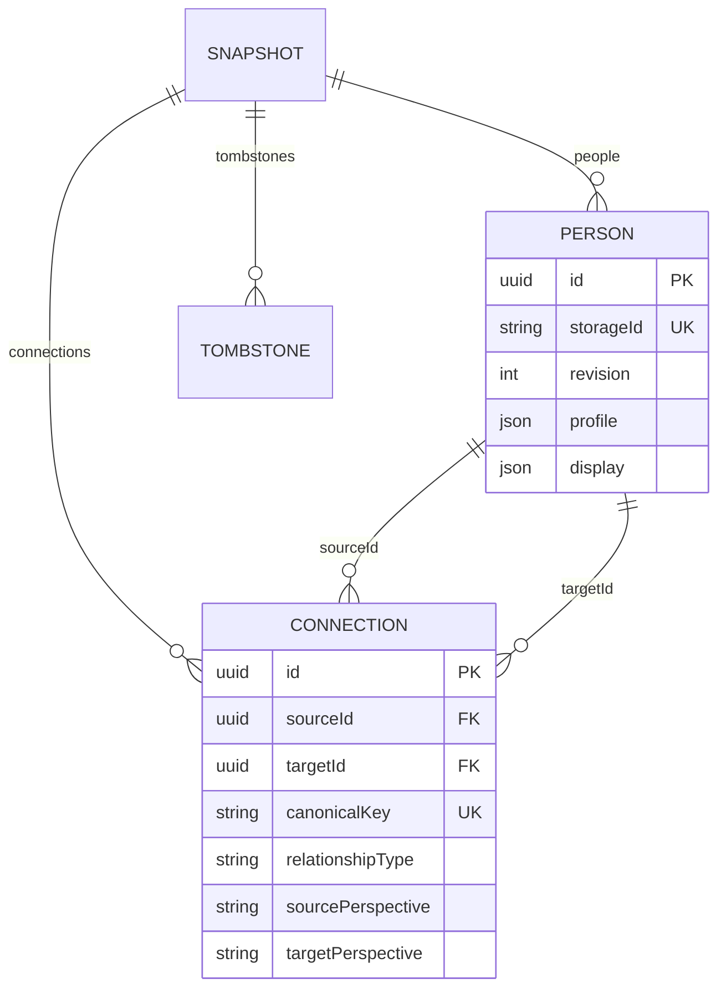

# Modelo de datos

El esquema actual es versión 1 y se valida mediante Zod en cliente, servidor e importación. Versiones desconocidas se rechazan sin escribir. `migrate()` es el punto de entrada para futuras migraciones; no se inventa una versión histórica 0.

`id` es un UUID inmutable. `storageId` se asigna una sola vez: clasificación inicial M/F/L/U y contador independiente. U es el valor predeterminado; el usuario no está obligado a clasificar a nadie. Cambiar el género no renombra el archivo. Los contadores nunca retroceden durante guardar, restaurar o deshacer.

La clave de conexión ordena ambos UUID y los une con `::`. Una edición desde el otro extremo conserva la misma conexión. Se rechazan autorrelaciones, extremos inexistentes, duplicados de UUID o nombre físico y relaciones a personas borradas.

El propietario se referencia en `ownerId`; el color principal se deriva de su conexión con cada persona. Una persona no conectada al propietario se muestra como conocida. Las perspectivas pertenecen a los extremos originales de la conexión, no al orden de la clave canónica.

Cada borrado normal produce tombstones para la persona y sus relaciones. Deshacer y restaurar son acciones explícitas del usuario, que pueden revertir una eliminación. La eliminación de toda la red conserva una copia recuperable; no se presenta como borrado irrecuperable.

Afinidad: `round((sum(pesoTipo * intensidad) / sum(intensidad) + 100) / 2)`. Pesos en `packages/graph-engine/metrics.ts`: 100, 75, 70, 45, 35, 20, −25 y −80. Sin relaciones se muestra un valor ausente, no cero. Todas las relaciones registradas, incluidas las finalizadas, participan actualmente en estas estadísticas.

Tamaño: entre 24 y 68 unidades, normalización logarítmica. Grado cuenta vecinos únicos. Puentes usa Tarjan iterativo, sin desbordamiento de pila en cadenas largas. Componentes y rutas usan recorridos lineales.
