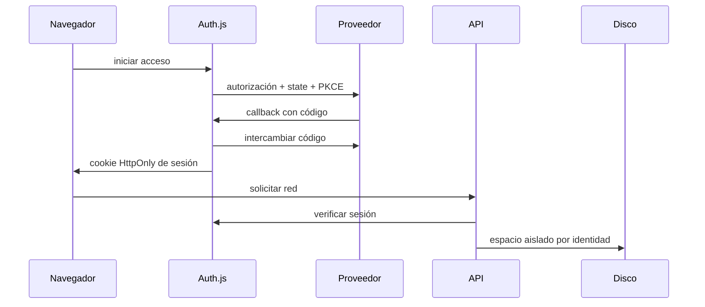

# Instalación y despliegue

## Desarrollo local

Requisitos: Node.js 22.13+ (rama 22) o 24+, npm y navegador moderno. El proyecto fue probado en Windows con Node 24 y Microsoft Edge.

```sh
npm ci
touch .env.local
npm run dev
```

PowerShell: usar `New-Item .env.local -ItemType File`. Si la política de PowerShell bloquea scripts npm, usar `npm.cmd`. Abrir `http://localhost:3000`.

En npm 12.0.2 se observó `EALLOWREMOTE` al resolver un tarball opcional de Tailwind alojado en el propio registro npm. La instalación comprobada en ese entorno utiliza `npm ci --allow-remote=all --registry=https://registry.npmjs.org`. El lockfile entregado solo contiene URLs de `registry.npmjs.org`. No se cambia la configuración global de npm ni se habilitan scripts de instalación desconocidos. En npm anteriores, usar primero el `npm ci` normal.

`AUTH_ENABLED=false` permite probar el núcleo sin credenciales. Seleccionar servidor, escribir el nombre del propietario y continuar. También se puede abrir la demo, que no escribe en el almacenamiento real.

## Producción Node

```sh
npm ci
npm run check
npm run build
npm run start
```

No ejecutar `next dev` y `next build` simultáneamente sobre la misma carpeta `.next`. El servidor de producción escucha en 127.0.0.1. Poner un reverse proxy HTTPS delante y configurar el mismo origen en `NEXTAUTH_URL`. Establecer `DATA_DIR` a una ubicación persistente privada con permisos del usuario del proceso. Respaldar fuera del host; los backups locales no protegen frente a pérdida del disco.

## Docker

```sh
docker compose up --build -d
docker compose logs -f graphlive
```

`.env.local` debe existir. Docker se ejecuta como usuario no root y publica solo `127.0.0.1:3000`. La imagen utiliza salida standalone y el volumen `graphlive-data`. El archivo Compose y Dockerfile están incluidos; la ejecución Docker requiere un daemon disponible y se indica como no verificada en esta entrega.

## OAuth

Activar `AUTH_ENABLED=true`, establecer `NEXTAUTH_SECRET` aleatorio y configurar al menos uno de los dos proveedores. Generar un secreto local, por ejemplo con `node -e "console.log(require('crypto').randomBytes(32).toString('hex'))"`; guardarlo directamente en el entorno, nunca en el repositorio.

Callbacks registrados en el proveedor:

- Google: `https://TU_DOMINIO/api/auth/callback/google`
- Microsoft: `https://TU_DOMINIO/api/auth/callback/azure-ad`

Google usa `GOOGLE_CLIENT_ID` y `GOOGLE_CLIENT_SECRET`; Microsoft usa `AZURE_AD_CLIENT_ID`, `AZURE_AD_CLIENT_SECRET` y opcionalmente `AZURE_AD_TENANT_ID`. La sesión es JWT cifrada por Auth.js y expira a las ocho horas. No se vinculan cuentas de proveedores diferentes por correo. Revocar una aplicación se realiza en el proveedor; no hay un gestor de proveedores vinculados en GraphLive.



## Variables

| Variable                                                                                         | Predeterminado / función                           |
| ------------------------------------------------------------------------------------------------ | -------------------------------------------------- |
| `AUTH_ENABLED`                                                                                   | false; activar para acceso por proveedor           |
| `NEXTAUTH_URL`                                                                                   | `http://localhost:3000`; origen exacto y callbacks |
| `NEXTAUTH_SECRET`                                                                                | obligatorio con autenticación                      |
| `GOOGLE_CLIENT_ID`, `GOOGLE_CLIENT_SECRET`                                                       | acceso Google                                      |
| `AZURE_AD_CLIENT_ID`, `AZURE_AD_CLIENT_SECRET`, `AZURE_AD_TENANT_ID`                             | acceso Microsoft                                   |
| `DATA_DIR`                                                                                       | `./data`; raíz privada persistente                 |
| `MAX_SNAPSHOT_BYTES`                                                                             | 10485760; límite servidor por snapshot             |
| `BACKUP_KEEP`                                                                                    | 10; número de backups retenidos por espacio        |
| `BACKUP_ENCRYPTION_KEY`                                                                          | opcional; 64 hex para AES-256-GCM                  |
| `NEXT_TELEMETRY_DISABLED`                                                                        | 1 en ejemplo y Docker                              |
| `LOCAL_FOLDER_ENABLED`                                                                           | true                                               |
| `SERVER_STORAGE_ENABLED`                                                                         | true                                               |
| `CUSTOM_FIELDS_ENABLED`                                                                          | true                                               |
| `GOOGLE_DRIVE_ENABLED`, `ONEDRIVE_ENABLED`, `SBOBY_PI_SHARE_ENABLED`, `CUSTOM_ENDPOINTS_ENABLED` | reservadas; no habilitan integraciones incompletas |
| `AVATARS_ENABLED`, `GRAPH_EDGE_CREATION_BY_DRAG`                                                 | reservadas; false efectivo                         |
| `PLAYWRIGHT_CHANNEL`                                                                             | `msedge` en pruebas locales; `chromium` en CI      |

## Resolución de problemas

- **403 al guardar**: el origen del navegador debe coincidir con `NEXTAUTH_URL`; `localhost` y `127.0.0.1` son diferentes.
- **Almacenamiento ocupado**: consultar recuperación de bloqueo en `storage.md`.
- **No aparece selector de carpetas**: usar Chromium/Edge en contexto seguro o el servidor.
- **Error de escritura**: verificar permisos/ACL y espacio en DATA_DIR; descargar cambios pendientes antes de cerrar.
- **Sesión expirada**: volver a acceder. No se borra la red.
- **Snapshot corrupto**: conservar copia de los archivos, no inicializar encima; restaurar un backup validado mediante procedimiento administrativo o importación en otro espacio.
- **Browser E2E ausente**: instalar Microsoft Edge o ejecutar `npx playwright install chromium` y establecer `PLAYWRIGHT_CHANNEL=chromium`.
- **El runner de pruebas no termina en un entorno Windows restringido**: el cierre automático del proceso del servidor puede quedar bloqueado aunque todos los casos hayan terminado. Con el servidor de pruebas ya escuchando en localhost:3100, establecer `PLAYWRIGHT_EXTERNAL_SERVER=true` y ejecutar E2E; el runner no intenta detener un proceso que no le pertenece. Esta vía se verificó con salida 0. No usar una instancia con datos personales para estas pruebas.
