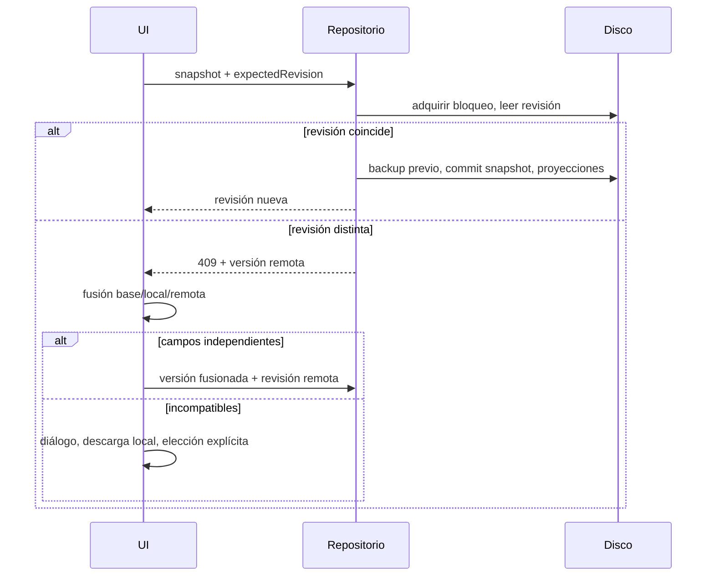

# Sincronización y recuperación

El cliente conserva la versión base. Cada 15 segundos consulta cambios remotos cuando no existen cambios pendientes. No reemplaza la red si el usuario empieza a editar durante la consulta. Los formularios trabajan con borradores; solo enviar el formulario modifica el dominio. Ediciones realizadas mientras hay una escritura se guardan después de ella.

Los objetos se fusionan campo a campo y las entidades por UUID. Arrays como intereses se consideran valores completos: dos cambios incompatibles generan conflicto en lugar de una unión potencialmente errónea. UUID duplicados, contadores incompatibles o referencias colgantes impiden guardar la fusión.

Para conflictos se conservan la versión local en memoria y la remota en el repositorio. El diálogo permite descargar la local y elegir explícitamente una versión; antes de aplicar la decisión se crea backup remoto. No hay un «último gana» silencioso. Todavía no hay selección visual campo por campo ni una cola offline durable: exportar los cambios pendientes antes de cerrar la pestaña.

Reintentos manuales no descartan el borrador. `retry()` ofrece backoff para adaptar operaciones idempotentes futuras, pero las escrituras no se reintentan a ciegas: un commit puede haberse realizado aunque la respuesta se haya perdido.

Backups automáticos: antes de guardar, si la preferencia está activada. Retención del servidor mediante `BACKUP_KEEP`. Backups manuales y vista previa de restauración disponibles desde configuración. Son snapshots históricos, no una tarea programada mientras la aplicación está cerrada.
